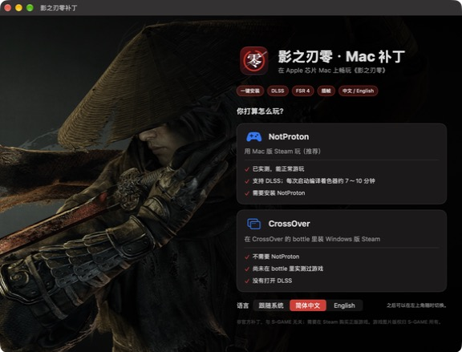
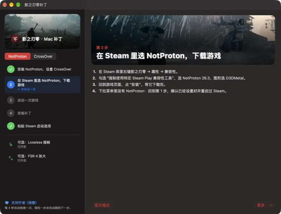
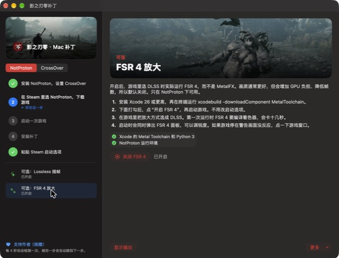

# 影之刃零 · Mac 补丁 / Phantom Blade Zero · Mac Patch

**中文** | [English](#english)

在 Apple 芯片 Mac 上，用 **NotProton + CrossOver 26.3** 运行 Steam 版《影之刃零》。附带图形界面的安装 App，一步一步带你装好。

> 非官方补丁，与 S-GAME 无关。你需要在 Steam 购买正版游戏。这是兼容性修复，不是破解。

## 下载

到右侧 **[Releases](../../releases)** 下载最新的 `PBZ-Mac-Patch-v1.0.zip`，解压后打开 App，按提示操作。

第一次打开如果提示“无法验证开发者”：右键点 App →“打开”，或者到“系统设置 → 隐私与安全性”点“仍要打开”。

## 功能

- 一键安装：Rosetta 下的 Denuvo 兼容修正、菜单视频（NV12）修正、D3DMetal 4.0b3
- 支持游戏内 DLSS（通过 MetalFX）
- 可选：FSR 4 放大（基于 fsr4-native-macos）
- 可选：Lossless Scaling 插帧（需要你自己购买 Lossless Scaling）
- 中文 / English 界面

 

## 需要

- Apple 芯片 Mac，macOS 26 或更高
- CrossOver 26.3（构建版本 26.3.0.39832）和 NotProton
- Steam 上已购买的《影之刃零》

已实测：M4 Pro、macOS 27、CrossOver 26.3.0.39832、NotProton、D3DMetal 4.0b3。

## 支持作者

制作补丁不易。补丁永久免费，如果它帮到了你，App 里有支付宝收款码，欢迎支持。

---

## English

Run the Steam version of *Phantom Blade Zero* on Apple silicon Macs with **NotProton + CrossOver 26.3**. Includes a step-by-step installer app.

> Unofficial patch, not affiliated with S-GAME. You need to own the game on Steam. This is a compatibility fix, not a crack.

**Download:** get the latest `PBZ-Mac-Patch-v1.0.zip` from **[Releases](../../releases)**, unzip and open the app. If macOS says it cannot verify the developer, right-click the app and choose Open.

**Features:** Rosetta CPU-feature fix for the game's Denuvo check, menu video (NV12) fix, D3DMetal 4.0b3, in-game DLSS via MetalFX, optional FSR 4 upscaling, optional Lossless Scaling frame generation (bring your own copy), Chinese / English UI.

**Requires:** Apple silicon Mac on macOS 26+, CrossOver 26.3 (build 26.3.0.39832), NotProton, and the game on Steam.

---

## 源码与构建 / Source and building

- `app/`：SwiftUI 安装 App。`bash app/build.sh` 生成 App 和 zip。
- `patch/`：命令行补丁脚本（`patch.sh`、`crossover.sh`）和组件。
- `patch/source/`：自编译 `ntdll.so` 用到的两个 Wine 源码补丁（CrossOver 26.3 源码，LGPL）。

两个大组件没有放进仓库，构建前需要放到 `patch/components/`：

- `gptk/`：苹果 Game Porting Toolkit 4.0 beta 3 的 `redist` 和许可文件
- `fsr4/`：[fsr4-native-macos](https://github.com/UzenUPoZiTiV4ik/fsr4-native-macos) v3.0（MIT）

Release 里的 App 已经包含这两个组件。

## 许可与致谢 / Licenses and credits

- 本项目自己的代码：MIT（见 `LICENSE`）
- `ntdll.so` 由 CrossOver 26.3 的 Wine 源码编译（LGPL-2.1），改动见 `patch/source/`；Rosetta CPU 修正补丁来自 Hrava
- D3DMetal / Game Porting Toolkit：© Apple，按苹果许可**非商业**免费分发，许可原文随组件附带
- FSR 4：fsr4-native-macos（MIT）及 AMD FidelityFX SDK（MIT）
- 游戏图片：《影之刃零》Steam 商店页官方宣传图，© S-GAME
- NotProton、CrossOver、Lossless Scaling、LsfgInjector 归各自作者所有，本项目不附带它们
